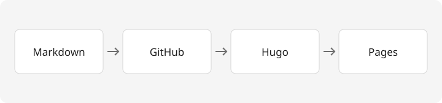

+++
title = '排版示例：Markdown、代码与图片'
date = 2026-10-16T08:00:00+08:00
slug = 'markdown-example'
draft = false
tags = ['Markdown', '博客']
description = '一篇用于验证博客排版的示例文章，包含目录、代码、表格和图片。'
summary = '【排版示例】这篇文章用于检查长文阅读体验：标题层级、中文与英文、代码高亮、引用、表格，以及与文章放在一起的图片。它不是正式技术文章，可以在发布自己的内容后删除。'
+++

> 这是一篇**排版示例**，用于检查博客功能，不是正式技术文章。发布自己的内容后，可以直接删除这个文章目录。

## 标题与正文

好的排版让读者把注意力放在内容上。普通正文可以包含 **重点**、*强调*、`行内代码`，以及 [外部资料链接](https://gohugo.io/documentation/)。

English text can sit alongside 中文内容。段落之间保留适当的间距，让长文阅读更轻松。

### 列表与引用

1. 提出一个具体问题。
2. 说明自己的理解和尝试。
3. 记录结果与下一步。

> 一篇笔记可以很短，只要它回答了一个真实的问题。

## 代码块

下面的代码仅用于展示语法高亮和复制按钮：

```python
from pathlib import Path

def list_articles(folder: str) -> list[str]:
    """List Markdown files in a local content directory."""
    return sorted(str(path) for path in Path(folder).rglob("*.md"))

print(list_articles("content/posts"))
```

## 表格

| 内容 | 保存位置 | 用途 |
| --- | --- | --- |
| 文章 | `content/posts/文章名/index.md` | 正文和元信息 |
| 图片 | 与 `index.md` 同目录 | 随文章一起管理 |
| 网站设置 | `hugo.toml` | 站名、导航和社交链接 |

## 图片

下面是本站原创的发布流程示意图。图片与文章放在同一目录，使用相对路径引用。



## 下一步

替换标题、日期、摘要和正文，把这份示例变成你自己的文章。具体操作可以查看 [仓库里的写作指南](https://github.com/xUxIAOrUI815/xuxiaorui815.github.io/blob/main/docs/writing.md)。
