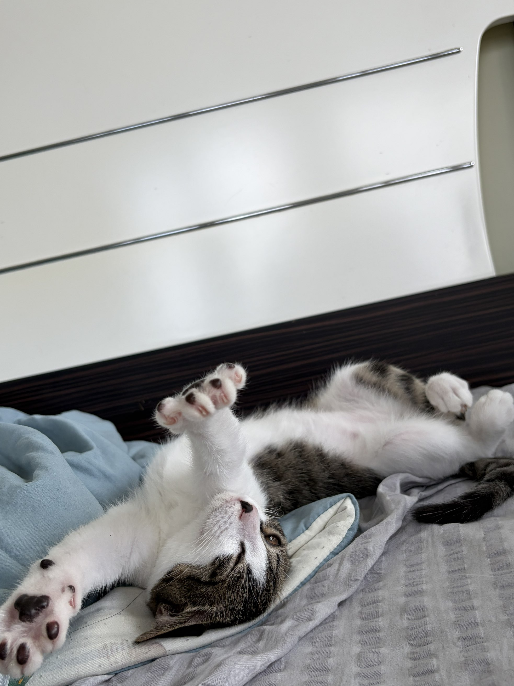
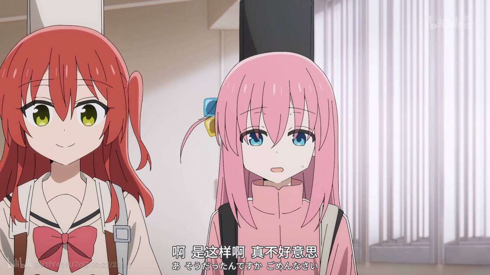

# 2026-苦夏

其实在国庆前就想写一些关于这个夏天的总结，一直拖延到了现在。。

## 工作

不知不觉在蚂蚁实习了5个月，在工作上似乎终于有些步入正轨。

方向也从业务agent开发转向了可观测和更偏向agent基建上。

实习的日子里遇到了非常多优秀的人，意识到自己的技术还有很多需要补充的地方。

总是想要什么都抓，就会陷入一种迷茫的状态。我觉得更多是浮躁吧，ai的编码能力是很强的，所以在想要深挖一个技术的时候常常静不下来，会不断反问现在学习这个是不是有意义的。对想要学习的东西没有那么坚定后，很容易中途放弃。

ai很大地占据了我自己思考的空间。实习期间可以说没有手写过一行代码，虽然对于大部分正职来说也是这样，但总会让我举得悬在半空，每一步都走得不是很实。 除了代码以外，学习新知识上也变得很浮躁。在看到新的技术名词、文章等，倾向于让ai直接解释或者生成可读性好、可交互的html文档，走马观花地看过后就没有深入的思考。  

最近迷茫的点在于，没有感受到自己的内在成长。 诚然，更适应互联网的研发节奏、需求交付的速度、对项目的熟练程度都提高了，但发现离开codex之后很难有自己的想法和代码能力。 

也许这个假设本身不对？ 不应该假设没有codex🤔 毕竟顺应时代是必然的。 但还是处在一种对自己的能力和价值很模糊的状态。

工作之外其实还是想反思一下自己的成长。 这一栏之后就会固定想一些个人的提升好了。

首先是写作能力，写到这一行的时候已经想过三次要放弃，很难写出一些逻辑性强的句子，现在的表达实在很贫瘠，阅读量也少的可怜。技术博客也常常憋了半天什么都说不出来，感觉自己并没有什么存储，只是一个cache。

其次是表达，最近在公司也发现，讲好故事比只会干活要重要的多。似乎需要系统地学习一下表达技巧🤔

第三是争取资源，意识到很多事情和机会不再像学校里会分配，需要主动提出想法和主导一件事。不是需要做到完美才交付，要及时汇报节点和进度，同步问题。

第四是持续的提升议价和增值，身边有很多人都有自己的副业，公司、自媒体账号等，在公司的好处是可以接触到更多有经历和经验的人，相比于学校，能了解到更多可能性。

第五是提前布局，这一点我觉得时常是有意识但是没有执行力的事情。比如个人ip、持续更新的博客等，都是从很久之前就想做但常常半途而废的，我觉得缺少一个持久的规划，我似乎对于这种需要长期积累的事情都很少坚持下来。 还是太浮躁和急于求成了。

## 生活

生活上似乎没什么可说的。 果然还是一个没有生活的人（

来杭州换过一次房子，最近有在考虑再换一次。

养了一只猫和一只狗，避免自己独处时过于，找不到一个形容词

过于缺乏重心吧。

需要一些其他的事情来抢占工作之外的时间。

---

十月去了新安江，算是整个十月唯一出去玩的一次🐱
这个十月还是太太太忙了

在新安江遇到了很好的司机，带着我玩了一圈，有点过于热情，让我很不习惯。

本来有打算保持联系，但是实在太忙，也觉得性格不是很合得来，保持很高的情绪价值实在很累，所以没有回复消息了。

不过确实给了我一些感受吧，上班确实很不自由，不断找到商机是一种很重要的能力。

十月看了一直很想看的 【孤独摇滚】 

## 规划

发现没存下来多少钱，很奇怪。 

对一些十几块钱的小开支没什么概念，导致不知不觉花了很多钱。。。

真的要好好管理一下工资了！

还有就是锻炼吧，十月份其实游过一次泳，然后爬坡。

瘦了一些，但还是没有到理想的体重。

没有什么减重的动力口牙！ 感觉精力不是很够用。

除此之外，一直想保持更新的个人账号和博客也没有坚持，回家之后就没有再打开电脑了，应该放个人电脑在家里，平常带着公司电脑的🤔 （毕竟要应急

本来想在今年的最后学一下车的，还是得等过年了。

最后就是持续更新简历和保持竞争力吧。

发现现在做的事还是让我没有底，但是因为缺乏经历和经验，很难做出合适的决策和判断，所以长久地处在一个迷茫期，感觉一切都是在建设和探索的初期，没有达到一个可以日常维护一下的状态。

任重道远啊

